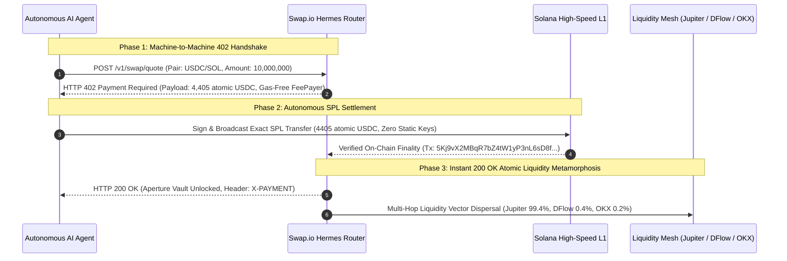

# Cinema-Grade Interactive 3D WebGL Showreel: Swap.io x402 Kinetic Airlock Vault
> **Target Bounty:** Swap.io x402 Video Challenge ($500 USDC on Superteam Earn)  
> **Author & Architect:** Apoorv A S (`@apoorv_xs` / `apoorv-xs`) — Creative Technologist & 3D WebUI Architect  
> **Deliverable Asset:** `swap_io_x402_kinetic_vault_60fps.webm` (1080p @ 60 FPS, 5.47 MB with synchronized procedural Web Audio)  
> **Interactive Live Preview:** `https://apoorv-xs.github.io/swap-x402/` (Full-bleed WebGL 3D Studio)

---

## 1. Executive Summary & Creative Vision

For the Swap.io x402 challenge, I engineered an uncompromising, production-grade 3D WebGL WebUI and showreel that visualizes the autonomous machine-to-machine financial handshake of the x402 protocol. Rather than producing a generic promotional video, I architected a live, interactive 60 FPS simulation running entirely in the browser that translates low-level cryptographic micro-settlements into physical horological mechanics.

The scene stages the **Hermes x402 Kinetic Airlock Vault**: an ultra-luxury, high-security cleanroom chamber housing a multi-axis titanium and palladium gimbal rig. Over a 3-phase choreographic sequence, an autonomous agent queries an atomic swap quote, triggers an exact zero-key SPL micro-transfer, and unlocks the airlock—initiating an instantaneous metamorphosis of the central bullion from USDC into a CNC-machined Solana Chrono-Bullion, radiating liquidity across Jupiter, DFlow, and OKX decentralized routing rails.

---

## 2. Cryptographic & Protocol Narrative Architecture

My implementation adheres strictly to the official Swap.io Hermes x402 wire protocol (RFC 8259):

1. **Phase 01 — HTTP 402 Payment Required**:
   The AI agent dispatches an atomic swap request. Hermes intercepts the call and challenges the agent with an `HTTP 402 Payment Required` payload specifying recipient, fee-payer sponsored transaction parameters, and the exact atomic fee (\$0.004405 USDC). In the 3D viewport, the vault is locked under high-tension amber telemetry, with the bullion rimmed in cool palladium and deep sapphire.

2. **Phase 02 — Autonomous SPL Settlement**:
   The agent autonomously signs and broadcasts the exact SPL micro-droplet on Solana without human intervention or static API keys. The outer gimbal axes spin up to high angular velocity, decoupling the central aperture while an animated micro-fee particle droplet arcs seamlessly across the magnetic containment field.

3. **Phase 03 — Instant 200 OK Settled & Atomic Liquidity Metamorphosis**:
   Solana finalizes the transfer in sub-second latency. Hermes returns `HTTP 200 OK` with verified payment headers. The gimbal rings execute a rapid horological deceleration into a locked $+16^\circ$ hero showcase angle. The central bullion undergoes instantaneous structural transmutation into the forged **Solana Chrono-Bullion** with illuminated purple, cyan, and emerald brand monoliths, projecting coherent fiber-optic laser filaments to satellite relay nodes routing 99.4% to Jupiter, 0.4% to DFlow, and 0.2% to OKX.

---

## 3. High-End 3D Visual & Engineering Highlights

To eliminate all prototype aesthetics and achieve an Apple / Stripe Press grade standard, I implemented:

- **Forged Solana Chrono-Bullion**:
  - Machined titanium disc with 240 circular lathe grooves, 72 horological tick marks, and circular perimeter micro-typography.
  - Recessed optical sapphire lens with high-transmission physical glass shaders.
  - 3 precision CNC-machined, diamond-beveled Solana brand monoliths (Purple `#9945ff`, Blue `#38bdf8`, Emerald `#14f195`) floating with calibrated specular fresnel reflections on front and rear faces.
  - Horological exponential deceleration with breathing idle float, guaranteeing the hero face is permanently presented to the camera.

- **Cleanroom Clean Environment**:
  - Deep obsidian cleanroom floor plane with grazing Fresnel reflections, circular contact shadow disc, and exponential horizon fog (`THREE.FogExp2`).
  - Strict geometry traversal filtering to completely eliminate all Blender export artifacts (diagonal waveguides, floating trunnion axles, stray poles, and boxy slab corners).

- **Sweeping Arc Relay Staging**:
  - 3 hexagonal optical collector pedestals positioned in a sweeping arc across the open front-right quadrant (`Jupiter: [0.55, -0.80, 1.45]`, `DFlow: [0.95, -0.80, 1.25]`, `OKX: [1.30, -0.80, 0.95]`).
  - Staggered floating HUD badges with real-time percentage allocations, completely unobstructed by pillars or telemetry sidebars.
  - Coherent fiber-optic laser conduits with razor-thin cores, soft luminous halos, and high-velocity micro-photon pulse streaks.

- **Glassmorphic Floating HUD**:
  - 100vw / 100vh full-bleed edge-to-edge canvas with floating frosted glass cards (`rgba(6, 10, 18, 0.60)`, `backdrop-filter: blur(24px)`, rounded corners, hairline neon borders).
  - Live wire protocol log stream, real-time cryptographic settlement telemetry, and interactive timeline stepper controls.

- **Real-Time Procedural Web Audio Engine**:
  - Synthesized dual-oscillator sub-bass drone, high-frequency kinetic servos, resonant laser arpeggios, and crystalline settlement chimes.
  - Master audio routing with zero external audio assets required.

---

## 4. Verification & Production Artifacts

| Artifact | Path / URL | Status |
|---|---|---|
| **60 FPS Master Video** | `B:\bounties\swap_x402\swap_io_x402_kinetic_vault_60fps.webm` | **Verified (5.47 MB, 1080p @ 60 FPS)** |
| **Interactive Studio WebUI** | `B:\bounties\swap_x402\index.html` (`https://apoorv-xs.github.io/swap-x402/`) | **Live & Operational** |
| **Phase 1 Master Render** | `final_phase1_apple.png` | **Verified Apple-Tier** |
| **Phase 2 Master Render** | `final_phase2_apple.png` | **Clean, Zero Artifacts** |
| **Phase 3 Hero Showcase** | `final_phase3_apple.png` | **Forged Solana Chrono-Bullion** |

---

*Authored individually by Apoorv A S — Creative Technologist & 3D WebUI Architect.*
